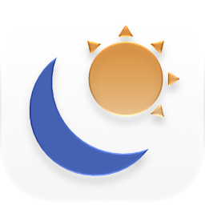

<p align="center">
  <picture>
    <source srcset="docs/images/app-icon-dark.png" media="(prefers-color-scheme: dark)">
    
  </picture>
</p>

<h1 align="center">Chromahora</h1>

<p align="center">A native iOS day planner for photographers.</p>

<p align="center">
  <a href="https://apps.apple.com/us/app/chromahora/id6817085752"></a>
</p>

Chromahora covers blue hour, golden hour, weather, cloud cover, UV, moon phase and dark skies, with an outlook that rates each stretch of the day's light.

Its home screen widgets show the next golden or blue hour, the next sunrise or sunset, the moon and tonight's dark sky, and the whole day's light at a glance.

On Apple Watch, the Digital Crown moves through the day's cards, and complications show when the next golden or blue hour starts and how promising it looks.

Sun and moon times come from [sunrise-sunset.org](https://sunrise-sunset.org), weather from [Apple WeatherKit](https://developer.apple.com/weatherkit/), and place search and town names from Apple Maps.

## Development

```sh
./scripts/setup.sh             # Install tools, a lint pre-commit hook, and the simulators the scripts use
./scripts/build.sh             # Build for the iOS Simulator, with the watch app it embeds
./scripts/run.sh -b            # Build and launch on a reachable iPhone or iPad, else the simulator (-s for the simulator, -w for the watch app)
./scripts/test.sh              # Run unit and snapshot tests
./scripts/snapshots.sh verify  # Compare snapshots against their baselines (record to update them)
./scripts/lint.sh              # Run SwiftLint
./scripts/screenshots.sh -b    # Build, then capture App Store screenshots (--dark for dark mode)
```

Live weather needs WeatherKit enabled for the App ID, under both Capabilities and App Services.

## License

Chromahora is licensed under the [GNU General Public License v3.0](LICENSE.md).
